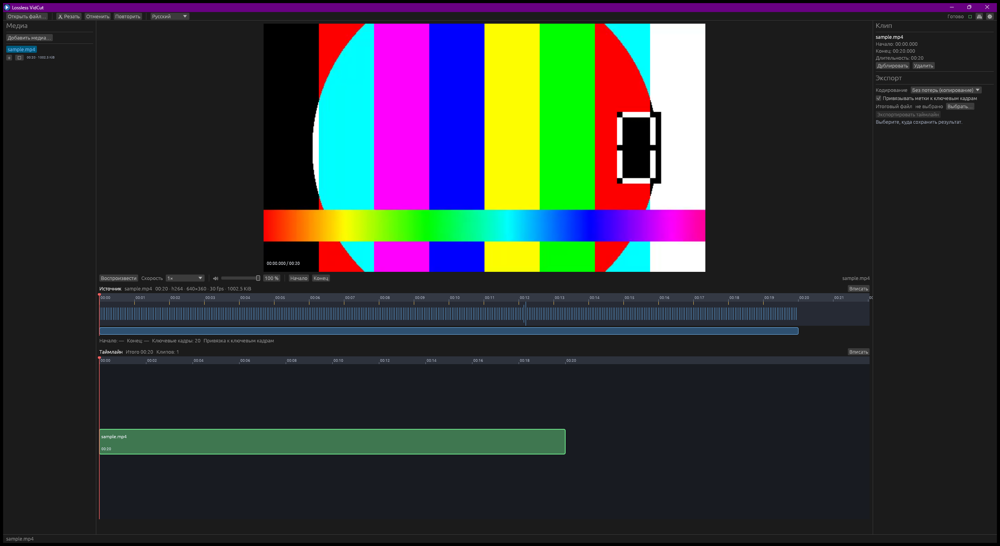
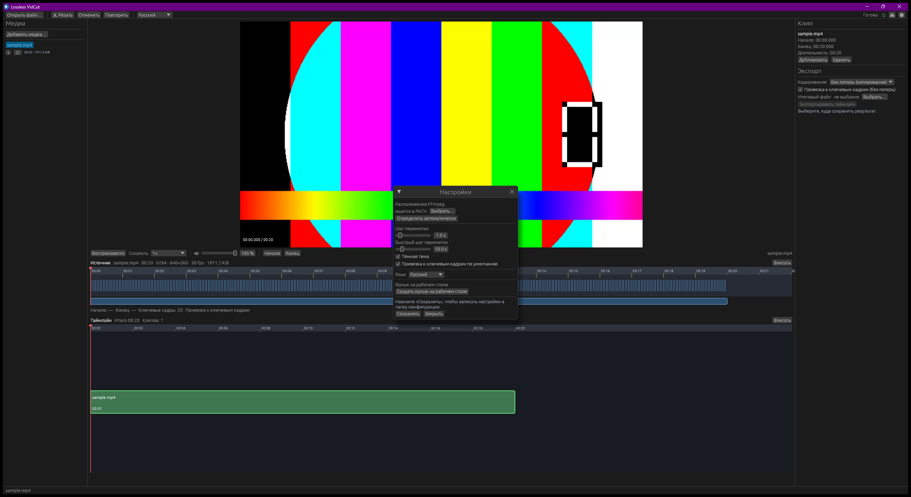

# Lossless VidCut

[](https://github.com/KosenkovPro/lossless-vidcut/actions/workflows/ci.yml)
[](https://github.com/KosenkovPro/lossless-vidcut/releases/latest)
[](LICENSE)

A fast, lightweight desktop application for **cutting and joining videos without
re-encoding them**. Written in Rust with a native `egui` interface, it runs on
Windows, Linux and macOS and only needs the `ffmpeg` command line tools that
most people already have installed.

The whole application is one timeline. Drop your videos onto it, cut them with
the scissors, drag the pieces into the order you want and export the result —
without ever re-encoding a frame.


---

## Why another video cutter?

* **Lossless by default.** A cut is a stream copy (`-c copy`), so the result is
  bit-identical to the source and takes as long as the file transfer, not as
  long as a re-encode.
* **One timeline, not two tools.** The splitter and the joiner are the same
  surface now: everything you cut becomes a clip, and every clip can be moved
  around freely.
* **The scissors come first.** <kbd>S</kbd> cuts the selected clip at the play
  head, exactly like the razor of Premiere or the blade of DaVinci Resolve.
* **Instant preview.** The timeline shows the waveform, every key frame and the
  clips you already cut. Scrubbing is smooth because the preview is decoded on
  the fly.
* **No surprises.** The application never guesses silently: the encoder that is
  used is detected from your FFmpeg build, incompatible files are reported
  before they are joined, and every failure ends up in the status bar.
* **Small dependency footprint.** The GUI is pure Rust, the file dialogs use the
  native pickers of your platform, and there is no bundled FFmpeg.
* **Speaks your language.** The interface is available in English and Russian,
  and you can switch at any time.

## Features

### The timeline

| | |
|---|---|
| Drag and drop | Drop one or more videos onto the window; every file becomes a clip on the timeline. |
| Preview with sound | The video is decoded by FFmpeg into raw frames, the audio is streamed through `rodio` to the sound card. |
| The scissors | <kbd>S</kbd>, <kbd>B</kbd> or <kbd>Ctrl</kbd>+<kbd>B</kbd> cut the clip under the play head. |
| Mark and extract | <kbd>I</kbd> and <kbd>O</kbd> mark a range in the source, <kbd>Enter</kbd> cuts it out as a new clip. |
| Drag to reorder | Grab a clip on the track and move it; the order is the order of the export. |
| Key frame aware | Every I-frame of the file is detected and drawn on the timeline; cut points can be snapped to them. |
| Waveform | The audio envelope is rendered behind the timeline. |
| Undo and redo | <kbd>Ctrl</kbd>+<kbd>Z</kbd> and <kbd>Ctrl</kbd>+<kbd>Shift</kbd>+<kbd>Z</kbd> cover every change of the timeline. |
| Lossless or precise | `-c copy` for instant cuts, or a re-encode for cuts that land exactly between two frames. |
| Compatibility check | Clips that do not share the same codec, resolution, frame rate or audio format are reported, with a hint to use the re-encoding mode. |
| Safe output | The result is never written over a file that belongs to the project. |

### The application

| | |
|---|---|
| No console window | On Windows the program is a real GUI application: neither it nor the FFmpeg processes it starts open a console. |
| English and Russian | The language is detected from the system on the first start and can be changed in the settings or in the toolbar. |
| Desktop shortcut | One button in the settings puts a shortcut on the desktop of the current user. |
| Portable | Unpack the archive and start the program — FFmpeg travels with it. |





## Requirements

* **FFmpeg 4.0 or newer**, including `ffprobe`. The application looks for both
  binaries in `PATH`; if they are somewhere else, point it at the folder with
  the *Locate FFmpeg…* button or in the settings.
* A sound card is optional. Without one the application still works, it simply
  plays video without audio.

The official releases ship FFmpeg and ffprobe next to the application binary,
so nothing has to be installed at all: unpack the archive and start the
program. If you prefer your own build, delete the two files and the
application falls back to `PATH`.

| Platform | How to install FFmpeg |
|---|---|
| **Windows** | `winget install Gyan.FFmpeg` or download a build from [ffmpeg.org](https://ffmpeg.org/download.html) |
| **Ubuntu / Debian** | `sudo apt install ffmpeg` |
| **macOS** | `brew install ffmpeg` |

## Downloads

Prebuilt archives are published on every release page. Each one contains the
application, a matching `ffmpeg` and `ffprobe`, and the license texts of both
projects.

| Archive | Platform |
|---|---|
| `lossless-vidcut-linux-x86_64.tar.gz` | Linux x86_64, glibc 2.35 or newer |
| `lossless-vidcut-windows-x86_64.zip` | Windows x86_64 |
| `lossless-vidcut-macos-aarch64.tar.gz` | macOS Apple Silicon |
| `lossless-vidcut-macos-x86_64.tar.gz` | macOS Intel |

The archives are produced by the release workflow in
`.github/workflows/release.yml`, which builds the application and FFmpeg from
source on every platform and publishes the result together with the checksums
and the complete corresponding source code of FFmpeg.

## Building from source

You need a current stable Rust toolchain (`rustup`) and the usual build
dependencies of your platform.

### Windows

```powershell
# Install the Rust toolchain and the MSVC build tools
winget install Rustlang.Rustup
winget install Microsoft.VisualStudio.2022.BuildTools --override "--wait --passive --add Microsoft.VisualStudio.Workload.VCTools --includeRecommended"

git clone https://github.com/KosenkovPro/lossless-vidcut.git
cd lossless-vidcut
cargo build --release
```

The binary is written to `target\release\lossless-vidcut.exe`.

### Ubuntu / Debian

```bash
sudo apt update
sudo apt install build-essential pkg-config libasound2-dev
curl --proto '=https' --tlsv1.2 -sSf https://sh.rustup.rs | sh
source "$HOME/.cargo/env"

git clone https://github.com/KosenkovPro/lossless-vidcut.git
cd lossless-vidcut
cargo build --release
```

The binary is written to `target/release/lossless-vidcut`.

The sound output of `rodio` uses ALSA, so `libasound2-dev` is the header
package that the build needs. The native file dialog of `rfd` talks to the
XDG desktop portal, which is present on every current desktop installation; a
headless server has no dialog and no file picker.

### macOS

```bash
xcode-select --install
curl --proto '=https' --tlsv1.2 -sSf https://sh.rustup.rs | sh
source "$HOME/.cargo/env"

git clone https://github.com/KosenkovPro/lossless-vidcut.git
cd lossless-vidcut
cargo build --release
```

The binary is written to `target/release/lossless-vidcut`. The application is
not code signed, so macOS may ask you to open it anyway: right click the
application and choose *Open*.

## Usage

### Cutting and joining

1. Press **Open file…** or drop one or more videos onto the window. Every file
   lands on the timeline as a clip and shows up in the media list on the left.
2. Select a clip on the timeline. The preview shows the file it came from, with
   the waveform and the key frames.
3. Move the play head to the place where you want to cut and press
   <kbd>S</kbd>. The clip is split in two and the second half is placed
   directly behind it.
4. Drag the pieces into the order you want. <kbd>Ctrl</kbd>+<kbd>Z</kbd> undoes
   a move, <kbd>Delete</kbd> removes a clip.
5. Choose the output file in the panel on the right and press **Export the
   timeline**.

In the lossless mode the cut is placed on the closest key frame, because a
stream copy can only begin there. The application tells you where the cut
landed and moves the boundary of the clip, so the exported file contains
exactly what the timeline shows. Switch the encoding to *Precise* if you want
the cut to land exactly between two frames — that re-encodes the material.

If you would rather cut an exact range out of a file, press <kbd>I</kbd> at the
beginning and <kbd>O</kbd> at the end and then <kbd>Enter</kbd>. The marked
range becomes a new clip on the timeline.

With **Snap to key frames** enabled the in and out points are pulled to the
closest I-frame. This is what a stream copy can actually deliver: cutting in
the middle of a group of pictures would require a re-encode of everything that
follows.

## Keyboard shortcuts

| Shortcut | Action |
|---|---|
| <kbd>Space</kbd> | Play / pause |
| <kbd>←</kbd> / <kbd>→</kbd> | Seek by the configured step (1 second by default) |
| <kbd>Shift</kbd> + <kbd>←</kbd> / <kbd>→</kbd> | Seek by the configured fast step (10 seconds by default) |
| <kbd>,</kbd> / <kbd>.</kbd> | One frame back / forward |
| <kbd>I</kbd> / <kbd>O</kbd> | Set the in / out point |
| <kbd>Ctrl</kbd> + <kbd>Shift</kbd> + <kbd>I</kbd> / <kbd>O</kbd> | Set the in / out point (DaVinci style) |
| <kbd>S</kbd>, <kbd>B</kbd>, <kbd>Ctrl</kbd> + <kbd>B</kbd> | **Cut** the clip under the play head |
| <kbd>Enter</kbd> | Cut the marked range into the timeline |
| <kbd>Home</kbd> / <kbd>End</kbd> | Jump to the beginning / the end |
| <kbd>Delete</kbd> | Delete the selected clip |
| <kbd>Ctrl</kbd> + <kbd>D</kbd> | Duplicate the selected clip |
| <kbd>Ctrl</kbd> + <kbd>A</kbd> | Select all clips |
| <kbd>Ctrl</kbd> + <kbd>Z</kbd> | Undo |
| <kbd>Ctrl</kbd> + <kbd>Shift</kbd> + <kbd>Z</kbd> | Redo |
| <kbd>+</kbd> / <kbd>-</kbd> | Zoom the timeline in / out |
| <kbd>Ctrl</kbd> + <kbd>0</kbd> | Fit the timeline into the window |
| <kbd>Ctrl</kbd> + <kbd>O</kbd> | Open a file |
| <kbd>Ctrl</kbd> + <kbd>E</kbd> | Export the timeline |
| <kbd>Ctrl</kbd> + <kbd>,</kbd> | Open the settings |
| <kbd>Ctrl</kbd> + <kbd>/</kbd> | Show the list of shortcuts |
| Mouse wheel on the timeline | Zoom in and out |
| <kbd>Shift</kbd> + mouse wheel | Scroll the timeline sideways |

The window with the <kbd>⌨</kbd> button in the toolbar shows the same list at
runtime. The length of the seek steps can be changed in the settings.

## How it works

The application never links against FFmpeg. Instead it starts the command line
tools as child processes and talks to them through pipes:

* **Preview** – `ffmpeg` writes raw RGB frames into a pipe that a decoder thread
  reads into a small queue, and the interface uploads the frame that belongs to
  the current play head into a texture. A second `ffmpeg` process produces
  interleaved float PCM that is drained by a `rodio` source.
* **Metadata** – `ffprobe` provides the duration, the codecs and the frame
  rate. The key frames are read from the packet index, which is much faster
  than decoding the file. The waveform is computed from mono 8 kHz PCM.
* **Cutting** – the cut is `ffmpeg -ss <start> -i <file> -t <duration> -c copy`,
  which is a stream copy. A stream copy can only begin at a key frame, so the
  cut points of the lossless mode are placed on the closest one and the
  timeline shows the real boundaries. The precise mode replaces `-c copy` with
  a real encoder, which is detected at runtime (`libx264`, `libopenh264`,
  `h264_nvenc` or `mpeg4`), and then the cut lands exactly where you pointed.
* **Joining** – every clip is cut into a temporary file, the files are listed
  in a concat demuxer list file and merged with `-f concat -safe 0 -c copy`.

Every FFmpeg job runs in a Tokio task, reports its progress through the
`-progress pipe:1` channel and can be cancelled with the *Cancel* button.

On Windows the program is linked against the `windows` subsystem, so it starts
without a console window. The FFmpeg processes it starts inherit the flag
`CREATE_NO_WINDOW`, so they do not flash a black window either. The log of a
release build is written to `%LOCALAPPDATA%\lossless-vidcut\vidcut.log`.

## Project layout

| Module | Responsibility |
|---|---|
| `src/main.rs` | Starts the `eframe` window and creates the application icon. |
| `src/app.rs` | The application shell: toolbar, panels, status bar and settings. |
| `src/editor.rs` | The unified editor: preview, source timeline, sequence track and inspector. |
| `src/project.rs` | The model of the media, the clips and the undo history. |
| `src/sequence.rs` | The track that shows the clips and drags them into order. |
| `src/player.rs` | The playback engine: video decoding, audio streaming, the clock. |
| `src/probe.rs` | Metadata, key frames and waveform peaks through `ffprobe`. |
| `src/timeline.rs` | The custom timeline widget with zoom, waveform and markers. |
| `src/processor.rs` | The FFmpeg command builders and the cancellable job runner. |
| `src/loader.rs` | Loads media metadata in the background. |
| `src/jobs.rs` | Background jobs with progress and cancellation. |
| `src/settings.rs` | The persisted user preferences. |
| `src/i18n.rs` | The English and Russian texts of the interface. |
| `src/shortcut.rs` | Creates and removes the shortcut on the desktop. |
| `src/sys.rs` | Platform helpers, for example the hidden console window. |
| `src/toast.rs` | The transient notifications. |
| `src/util.rs` | Time code and byte formatting helpers. |
| `src/ffmpeg_tools.rs` | Locating the `ffmpeg` and `ffprobe` binaries. |

## Settings

The settings are stored as JSON in the platform configuration directory:

| Platform | Location |
|---|---|
| Windows | `%APPDATA%\lossless-vidcut\settings.json` |
| Linux | `~/.config/lossless-vidcut/settings.json` |
| macOS | `~/Library/Application Support/lossless-vidcut/settings.json` |

| Setting | Meaning |
|---|---|
| FFmpeg location | The folder that contains `ffmpeg` and `ffprobe`. Empty means *look in `PATH`*. |
| Seek step | The length of <kbd>←</kbd> and <kbd>→</kbd>. |
| Fast seek step | The length of <kbd>Shift</kbd>+<kbd>←</kbd> and <kbd>Shift</kbd>+<kbd>→</kbd>. |
| Snap to key frames | Whether the in and out markers are pulled to the closest I-frame. The cut points of the lossless mode always land on a key frame, because a stream copy cannot do anything else. |
| Language | English or Russian. |
| Desktop shortcut | Creates or removes the shortcut on the desktop. |

## Development

```bash
cargo check --all-targets   # type check everything
cargo test                   # unit and integration tests
cargo clippy --all-targets   # lint
cargo fmt --check            # formatting
cargo run                    # start the application
```

## License

The application itself is MIT, see [LICENSE](LICENSE).

The official releases additionally contain `ffmpeg` and `ffprobe`, which are
separate programs that the application starts as child processes. They are
built from source with `--enable-gpl --enable-version3` and are therefore
distributed under the GNU General Public License version 3 or later. Their
license texts (`COPYING.GPLv3` and `COPYING.LGPLv3`) and the complete
corresponding source code are part of every release archive.

This software uses code from the [FFmpeg](https://ffmpeg.org) project under
the GPLv3, and its source can be downloaded from
<https://ffmpeg.org/download.html>.
