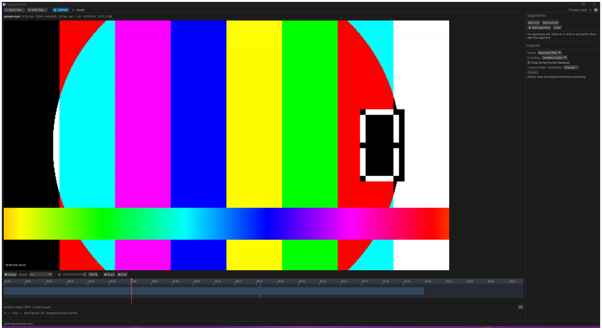

# Lossless VidCut

A fast, lightweight desktop application for **splitting and joining videos without
re-encoding them**. Written in Rust with a native `egui` interface, it runs on
Windows, Linux and macOS and only needs the `ffmpeg` command line tools that
most people already have installed.



---

## Why another video cutter?

* **Lossless by default.** A cut is a stream copy (`-c copy`), so the result is
  bit-identical to the source and takes as long as the file transfer, not as
  long as a re-encode.
* **Instant preview.** The timeline shows the waveform, every key frame and the
  segments you selected. Scrubbing is smooth because the preview is decoded on
  the fly.
* **No surprises.** The application never guesses silently: the encoder that is
  used is detected from your FFmpeg build, incompatible files are reported
  before they are joined, and every failure ends up in the status bar.
* **Small dependency footprint.** The GUI is pure Rust, the file dialogs use the
  native pickers of your platform, and there is no bundled FFmpeg.

## Features

### Splitter

| | |
|---|---|
| Preview with sound | The video is decoded by FFmpeg into raw frames, the audio is streamed through `rodio` to the sound card. |
| Frame accurate navigation | `,` and `.` step a single frame forwards and backwards. |
| Key frame aware | Every I-frame of the file is detected and drawn on the timeline; cut points can be snapped to them. |
| Waveform | The audio envelope is rendered behind the timeline. |
| Segment list | Segments can be previewed, reordered by removing and re-adding, and deleted individually. |
| Two export modes | Either write every segment into its own file, or cut the unwanted parts away and glue the rest together. |
| Lossless or precise | `-c copy` for instant cuts, or a re-encode for cuts that land exactly between two frames. |

### Joiner

| | |
|---|---|
| Drag and drop | Drop several files onto the window, or pick them with the native dialog. |
| Format overview | Codec, resolution, frame rate, duration and size of every file. |
| Reordering | Drag the handle of a row to change the order. |
| Compatibility check | Files that do not share the same codec, resolution or frame rate are reported, with a hint to use the re-encoding mode. |

## Requirements

* **FFmpeg 4.0 or newer**, including `ffprobe`. The application looks for both
  binaries in `PATH`; if they are somewhere else, point it at the folder with
  the *Locate FFmpeg…* button or in the settings.
* A sound card is optional. Without one the application still works, it simply
  plays video without audio.

| Platform | How to install FFmpeg |
|---|---|
| **Windows** | `winget install Gyan.FFmpeg` or download a build from [ffmpeg.org](https://ffmpeg.org/download.html) |
| **Ubuntu / Debian** | `sudo apt install ffmpeg` |
| **macOS** | `brew install ffmpeg` |

## Building from source

You need a current stable Rust toolchain (`rustup`) and the usual build
dependencies of your platform.

### Windows

```powershell
# Install the Rust toolchain and the MSVC build tools
winget install Rustlang.Rustup
winget install Microsoft.VisualStudio.2022.BuildTools --override "--wait --passive --add Microsoft.VisualStudio.Workload.VCTools --includeRecommended"

git clone https://github.com/KosenkovPro/lossless-vidcut.git
cd lossless-vidcut
cargo build --release
```

The binary is written to `target\release\lossless-vidcut.exe`.

### Ubuntu / Debian

```bash
sudo apt update
sudo apt install build-essential pkg-config libssl-dev
curl --proto '=https' --tlsv1.2 -sSf https://sh.rustup.rs | sh
source "$HOME/.cargo/env"

git clone https://github.com/KosenkovPro/lossless-vidcut.git
cd lossless-vidcut
cargo build --release
```

The binary is written to `target/release/lossless-vidcut`.

The native file dialog is provided by `rfd`, which uses
[GTK 3](https://packages.ubuntu.com/search?keywords=libgtk-3-dev) on Linux:

```bash
sudo apt install libgtk-3-dev
```

### macOS

```bash
xcode-select --install
curl --proto '=https' --tlsv1.2 -sSf https://sh.rustup.rs | sh
source "$HOME/.cargo/env"

git clone https://github.com/KosenkovPro/lossless-vidcut.git
cd lossless-vidcut
cargo build --release
```

The binary is written to `target/release/lossless-vidcut`. The application is
not code signed, so macOS may ask you to open it anyway: right click the
application and choose *Open*.

## Usage

### Cutting a file

1. Press **Open file…** or drop a file onto the window.
2. Scrub through the timeline. The play head, the waveform and the key frame
   markers give you a good overview of the material.
3. Press <kbd>I</kbd> at the beginning and <kbd>O</kbd> at the end of the part
   you want to keep, then press **Add segment**.
4. Choose between **Separate files** and **Single file** and press **Export**.

With **Snap to key frames** enabled the in and out points are pulled to the
closest I-frame. This is what a stream copy can actually deliver: cutting in
the middle of a group of pictures would require a re-encode of everything that
follows.

### Joining files

1. Drop the files onto the window or press **Add files…**.
2. Drag the handle on the left of a row to change the order.
3. Choose the output file and press **Join files**.

If the files do not share the same format, the application says so and offers
the **Precise** mode, which re-encodes everything into a common format.

## Keyboard shortcuts

| Shortcut | Action |
|---|---|
| <kbd>Space</kbd> | Play / pause |
| <kbd>←</kbd> / <kbd>→</kbd> | Seek by the configured step (1 second by default) |
| <kbd>Shift</kbd> + <kbd>←</kbd> / <kbd>→</kbd> | Seek by the configured fast step (10 seconds by default) |
| <kbd>,</kbd> | One frame back |
| <kbd>.</kbd> | One frame forward |
| <kbd>I</kbd> | Set the in point of a segment |
| <kbd>O</kbd> | Set the out point of a segment |
| Mouse wheel on the timeline | Zoom in and out |
| <kbd>Shift</kbd> + mouse wheel | Scroll the timeline sideways |

The length of the seek steps can be changed in the settings.

## How it works

The application never links against FFmpeg. Instead it starts the command line
tools as child processes and talks to them through pipes:

* **Preview** – `ffmpeg` writes raw RGB frames into a pipe that a decoder thread
  reads into a small queue, and the interface uploads the frame that belongs to
  the current play head into a texture. A second `ffmpeg` process produces
  interleaved float PCM that is drained by a `rodio` source.
* **Metadata** – `ffprobe` provides the duration, the codecs and the frame
  rate. The key frames are read from the packet index, which is much faster
  than decoding the file. The waveform is computed from mono 8 kHz PCM.
* **Cutting** – the cut is `ffmpeg -ss <start> -i <file> -t <duration> -c copy`,
  which is a stream copy. The precise mode replaces `-c copy` with a real
  encoder, which is detected at runtime (`libx264`, `libopenh264`, `h264_nvenc`
  or `mpeg4`).
* **Joining** – the files are listed in a concat demuxer list file and merged
  with `-f concat -safe 0 -c copy`.

Every FFmpeg job runs in a Tokio task, reports its progress through the
`-progress pipe:1` channel and can be cancelled with the *Cancel* button.

## Project layout

| Module | Responsibility |
|---|---|
| `src/main.rs` | Starts the `eframe` window and creates the application icon. |
| `src/app.rs` | The application shell: tabs, toolbars, status bar and settings. |
| `src/splitter.rs` | The splitter tab: preview, cut points, segments and export. |
| `src/joiner.rs` | The joiner tab: file list, reordering and the format check. |
| `src/player.rs` | The playback engine: video decoding, audio streaming, the clock. |
| `src/probe.rs` | Metadata, key frames and waveform peaks through `ffprobe`. |
| `src/timeline.rs` | The custom timeline widget with zoom, waveform and markers. |
| `src/processor.rs` | The FFmpeg command builders and the cancellable job runner. |
| `src/loader.rs` | Loads media metadata in the background. |
| `src/jobs.rs` | Background jobs with progress and cancellation. |
| `src/settings.rs` | The persisted user preferences. |
| `src/toast.rs` | The transient notifications. |
| `src/util.rs` | Time code and byte formatting helpers. |
| `src/ffmpeg_tools.rs` | Locating the `ffmpeg` and `ffprobe` binaries. |

## Settings

The settings are stored as JSON in the platform configuration directory:

| Platform | Location |
|---|---|
| Windows | `%APPDATA%\lossless-vidcut\settings.json` |
| Linux | `~/.config/lossless-vidcut/settings.json` |
| macOS | `~/Library/Application Support/lossless-vidcut/settings.json` |

## Development

```bash
cargo check --all-targets   # type check everything
cargo test                   # run the unit tests
cargo clippy --all-targets   # lint
cargo run                    # start the application
```

## License

MIT, see [LICENSE](LICENSE).
